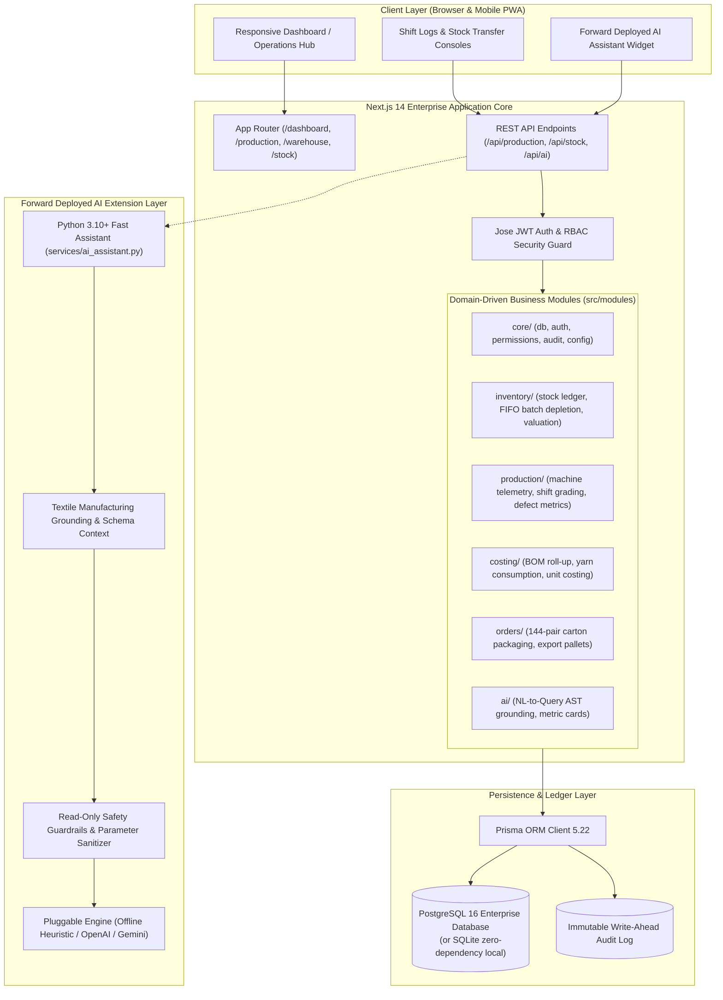
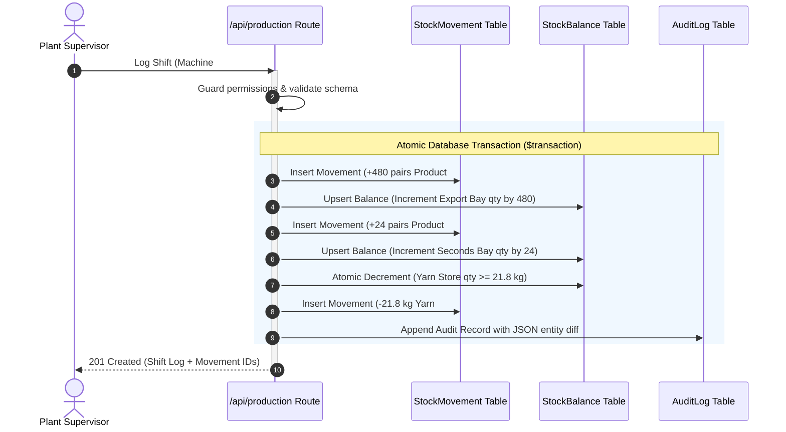

# ThreadCraft ERP: Enterprise Apparel Manufacturing & Operations Platform

[](https://nextjs.org/)
[](https://www.typescriptlang.org/)
[](https://www.prisma.io/)
[](https://www.postgresql.org/)
[](https://www.docker.com/)
[](https://www.python.org/)
[](https://opensource.org/licenses/MIT)

> **ThreadCraft ERP** is a production-grade, domain-driven Enterprise Resource Planning (ERP) platform engineered for modern textile and apparel manufacturing facilities. It digitizes the complete operations lifecycle—from raw yarn spool intake and batch/lot allocation to high-speed circular knitting machine telemetry, dual-grade quality inspection, double-entry inventory ledger tracking, carton packaging, and an integrated **Forward Deployed AI Operations Assistant**.

---

## 📑 Table of Contents
1. [Executive Summary & Problem Statement](#-executive-summary--problem-statement)
2. [System Architecture](#-system-architecture)
3. [Domain-Driven Modules](#-domain-driven-modules)
4. [Double-Entry Stock Ledger & Atomic Guarantees](#-double-entry-stock-ledger--atomic-guarantees)
5. [Forward Deployed AI Assistant Layer](#-forward-deployed-ai-assistant-layer)
6. [Interactive Operations Command Hub](#-interactive-operations-command-hub)
7. [API Reference](#-api-reference)
8. [Database Schema & Migrations](#-database-schema--migrations)
9. [Quickstart & Local Deployment](#-quickstart--local-deployment)
10. [Testing & Quality Assurance](#-testing--quality-assurance)

---

## 🎯 Executive Summary & Problem Statement

Textile and apparel factories operate in high-velocity, razor-thin margin environments. Traditional legacy software fails on shop floors because it treats physical manufacturing as disconnected spreadsheet entries:
* **The Raw Material Blindspot:** Raw yarn (e.g., 30/1 combed cotton, 20/1 poly-cotton, 70D Lycra) fluctuates by lot number, vendor twist quality, and weight per cone. Without FIFO batch tracking, material usage variances quietly erode factory profitability.
* **Knitting Telemetry Gaps:** High-speed knitting machines (Lonati Donna, Sangiacomo HT, 144N to 200N needle cylinders spinning at 280+ RPM) generate output across 10-hour and 12-hour shifts. Delays in shift logging create discrepancies between floor output and warehouse stock.
* **Dual-Stream Quality Sorting:** Socks are graded on the inspection table into **Category A (Export Grade First Quality)** and **Category B (Factory Seconds / Irregulars)**. Failing to partition these grades into isolated warehouse bays leads to customer chargebacks or inventory miscounts.
* **Ledger Inconsistency & Race Conditions:** Editing stock directly in database tables invites concurrency race conditions and untraceable inventory theft.

**ThreadCraft ERP solves these challenges** through an immutable double-entry stock movement ledger, strict atomic decrements, batch lot traceability, automated carton packing calculations (144 pairs / 12 dozen per master carton), and a schema-grounded AI Assistant.

---

## 🏗 System Architecture

ThreadCraft ERP employs a clean, modular architecture separating presentation, domain business rules, immutable data persistence, and an enterprise AI extension layer.



---

## 📦 Domain-Driven Modules

The application is structured into domain packages under [`socks-erp/src/modules/`](file:///c:/Users/talha/Downloads/socks-erp/socks-erp/src/modules/):

### 1. `core/` (Foundational Services)
* **[`db.ts`](file:///c:/Users/talha/Downloads/socks-erp/socks-erp/src/modules/core/db.ts):** Global typed Prisma client singleton with query logging and connection pooling.
* **[`auth.ts`](file:///c:/Users/talha/Downloads/socks-erp/socks-erp/src/modules/core/auth.ts):** Cryptographic JWT token generation and verification using `jose` with HTTP-Only cookie security flags.
* **[`permissions.ts`](file:///c:/Users/talha/Downloads/socks-erp/socks-erp/src/modules/core/permissions.ts):** Role-Based Access Control (RBAC) engine supporting 5 seeded enterprise roles (`Admin`, `Production Manager`, `Store Manager`, `Sales/User`, `Accountant`).
* **[`audit.ts`](file:///c:/Users/talha/Downloads/socks-erp/socks-erp/src/modules/core/audit.ts):** Write-ahead audit logging persisting before/after entity JSON diffs.
* **[`config.ts`](file:///c:/Users/talha/Downloads/socks-erp/socks-erp/src/modules/core/config.ts):** Zod-validated environment configuration.

### 2. `inventory/` (Ledger & Valuation)
* **[`stock.ts`](file:///c:/Users/talha/Downloads/socks-erp/socks-erp/src/modules/inventory/stock.ts):** Core double-entry inventory engine. Enforces immutable `StockMovement` creation paired with atomic `StockBalance` running cache updates.
* **[`depletion.ts`](file:///c:/Users/talha/Downloads/socks-erp/socks-erp/src/modules/inventory/depletion.ts):** Batch and lot depletion engine executing FIFO, LIFO, and specific lot allocations with remaining balance verification.
* **[`valuation.ts`](file:///c:/Users/talha/Downloads/socks-erp/socks-erp/src/modules/inventory/valuation.ts):** Moving Weighted Average Cost (MAC) and asset valuation roll-ups across raw yarn and finished goods.

### 3. `production/` (Knitting Floor Operations)
* **[`telemetry.ts`](file:///c:/Users/talha/Downloads/socks-erp/socks-erp/src/modules/production/telemetry.ts):** Cylinder specifications, needle density (144N, 168N, 200N), target velocity (dozen/hour), and Overall Equipment Effectiveness (OEE) metrics.
* **[`shifts.ts`](file:///c:/Users/talha/Downloads/socks-erp/socks-erp/src/modules/production/shifts.ts):** Shift logging logic for 10-hour and 12-hour day/night shifts, dual-stream sorting (**Category A** vs **Category B**), and defect rate calculations.

### 4. `costing/` (Apparel Unit Costing & BOM)
* **[`unit-costing.ts`](file:///c:/Users/talha/Downloads/socks-erp/socks-erp/src/modules/costing/unit-costing.ts):** Bill of Materials (BOM) engine calculating yarn consumption per pair (grams) and per dozen (kg), knitting scrap/waste factor (3–5%), elastic Lycra allowance, labor overhead, and packaging costs.

### 5. `orders/` (Packaging & Fulfillment)
* **[`fulfillment.ts`](file:///c:/Users/talha/Downloads/socks-erp/socks-erp/src/modules/orders/fulfillment.ts):** Master export carton conversion ($1\text{ Carton} = 144\text{ Pairs} = 12\text{ Dozen}$), loose pair handling, pallet packaging (30 cartons/pallet), and gross shipping weight calculations.

### 6. `ai/` (Forward Deployed Query Engine)
* **[`query-engine.ts`](file:///c:/Users/talha/Downloads/socks-erp/socks-erp/src/modules/ai/query-engine.ts):** Schema-grounded natural language query engine that translates operations questions into executable database queries, metric cards, and actionable recommendations.

---

## ⚖️ Double-Entry Stock Ledger & Atomic Guarantees

Stock balances are **never modified directly**. Every physical material adjustment is recorded as an immutable movement row:



* **Negative Stock Prevention:** Concurrency-safe atomic check:
  ```typescript
  const updated = await tx.stockBalance.updateMany({
    where: { itemKey, warehouseId: m.warehouseId, qty: { gte: m.qty } },
    data: { qty: { decrement: m.qty } },
  });
  if (updated.count === 0) throw new Error("Insufficient stock in warehouse.");
  ```

---

## 🤖 Forward Deployed AI Assistant Layer

ThreadCraft ERP features an AI extension layer designed to meet the rigorous standards expected of **Forward Deployed AI Engineers (FDE)**:

### 1. Architectural Highlights
* **Domain Grounding:** Injects apparel manufacturing schema context, needle count telemetry, grading rules, and warehouse topologies into the agent's semantic context.
* **Deterministic Fallback Engine:** Features a zero-dependency, rule-based heuristic parsing engine that operates with 100% offline accuracy—eliminating demo flakiness and high-cost API dependencies while supporting pluggable OpenAI/Gemini models when API keys are configured.
* **Read-Only Safety Guardrails:** Strict SQL AST inspection blocks any destructive DDL/DML operations (`DROP`, `DELETE`, `UPDATE`, `TRUNCATE`, `ALTER`, or SQL injection vectors).

### 2. Standalone Python Microservice (`services/ai_assistant.py`)
Run queries directly from the command line:
```bash
python services/ai_assistant.py "Show me stock levels for low-inventory cotton yarn"
```
**Sample Structured Output:**
```json
{
  "intent": "INVENTORY_LEVELS",
  "confidence": 0.96,
  "domain": "Yarn & Raw Material Inventory",
  "summary": "Identified low-inventory yarn materials requiring purchase replenishment.",
  "grounded_sql": "SELECT m.code, m.name, m.yarn_type, COALESCE(SUM(sb.qty), 0) AS current_stock_kg, m.reorder_level FROM \"Material\" m LEFT JOIN \"StockBalance\" sb ON sb.material_id = m.id WHERE m.is_active = true GROUP BY m.id HAVING COALESCE(SUM(sb.qty), 0) <= m.reorder_level ORDER BY current_stock_kg ASC;",
  "parameters": {
    "material_type": "cotton",
    "filter": "stock_lte_reorder_level"
  },
  "safety_passed": true,
  "suggested_actions": [
    "Inspect supplier lead times for cotton 30/1 spools",
    "Issue Material Purchase Order against Yarn Store (Warehouse #1)"
  ]
}
```

Run as a standalone HTTP microservice:
```bash
python services/ai_assistant.py --serve --port 8000
```

---

## 🖥 Interactive Operations Command Hub

The Next.js web application includes the **Forward Deployed AI Assistant** embedded directly in the main operations dashboard:
* **One-Click Quick Queries:** Instant access to yarn stock status, machine telemetry, shift defect metrics, carton packing forecasts, and unit cost calculations.
* **Live KPI Badges:** Real-time metrics detailing active knitting lines, export vs. seconds dozen counts, and warehouse inventory volumes.
* **Grounded SQL / AST Inspection:** Plant managers can inspect the exact SQL query and safety check passed by the AI agent for complete operational transparency.

---

## 📡 API Reference

All write endpoints enforce JWT session authentication and Role-Based Access Control (RBAC).

| Method | Endpoint | Description | Auth / Role |
| :--- | :--- | :--- | :--- |
| `POST` | `/api/auth/login` | Authenticate user & issue 12-hour session cookie | Public |
| `POST` | `/api/auth/logout` | Revoke session cookie | Authenticated |
| `GET` | `/api/production` | List machines, logs, output metrics & stats | `production:view` |
| `POST` | `/api/production` | Record shift run, dual-grade sorting & auto-sync stock | `production:create` |
| `GET` | `/api/stock` | Query inventory ledger, warehouses & balances | `stock:view` |
| `POST` | `/api/stock` | Record movement (STOCK_IN, STOCK_OUT, TRANSFER) | `stock:create` |
| `GET` | `/api/materials` | List raw yarn & material catalog | `materials:view` |
| `POST` | `/api/materials` | Create new yarn material record | `materials:create` |
| `GET` | `/api/products` | List finished product catalog | `products:view` |
| `POST` | `/api/products` | Create finished apparel product | `products:create` |
| `GET` | `/api/warehouse` | List storage warehouses & running balances | `warehouse:view` |
| `POST` | `/api/ai/query` | Forward Deployed AI natural language query interpreter | Authenticated |

---

## 🗄 Database Schema & Migrations

The database models are specified in [`socks-erp/prisma/schema.prisma`](file:///c:/Users/talha/Downloads/socks-erp/socks-erp/prisma/schema.prisma) and represented as an enterprise PostgreSQL migration script in [`socks-erp/prisma/migrations/0_init/migration.sql`](file:///c:/Users/talha/Downloads/socks-erp/socks-erp/prisma/migrations/0_init/migration.sql).

### Key Entities:
1. `Role` & `Permission`: Module-based RBAC rights (`view`, `create`, `edit`, `delete`).
2. `User`: Encrypted credentials (`bcryptjs`) with relational role mapping.
3. `Warehouse`: Segregated storage (`RAW`, `FINISHED`, `PACKAGING`, `SECONDS`).
4. `Material` & `MaterialBatch`: Fiber composition, yarn count, lot numbers, and cost rates.
5. `Product`: Apparel specifications, sizes, colors, carton quantities, and standard weights.
6. `Machine`: Circular knitting cylinder diameter, needle count (144N–200N), target velocity, and operating status.
7. `ProductionLog`: Shift output records, operator assignments, Category A/B dozens, yarn consumed, efficiency, and defect rate.
8. `StockMovement`: Ledger tracking direction (+1 / -1), quantity, warehouse, batch, and references.
9. `StockBalance`: Real-time composite cached balance `(itemKey, warehouseId)`.
10. `AuditLog`: Write-ahead entity modification logs with before/after snapshots.

---

## 🚀 Quickstart & Local Deployment

### Option A: Docker Compose (Recommended)
Launch the entire platform (PostgreSQL 16 + Next.js App) with a single command:

```bash
# 1. Clone repository
git clone https://github.com/your-username/threadcraft-erp.git
cd threadcraft-erp

# 2. Configure environment
cp .env.example .env

# 3. Build & start containers
docker compose up --build
```
Open [http://localhost:3000](http://localhost:3000) and sign in with:
* **Username:** `admin`
* **Password:** `AdminSecurePassword123!` (or the value set in `SEED_ADMIN_PASSWORD`)

---

### Option B: Local Node.js Development
```bash
# 1. Install dependencies
cd socks-erp
npm install

# 2. Configure local environment
cp .env.example .env

# 3. Synchronize database & seed demo data
npx prisma db push
npm run db:seed

# 4. Start local development server
npm run dev
```

Visit [http://localhost:3000](http://localhost:3000) to access the operations dashboard.

---

## 🧪 Testing & Quality Assurance

### 1. Build Verification
Validate Next.js compilation, TypeScript types, and route handlers:
```bash
npm --prefix socks-erp run build
```

### 2. AI Assistant Unit Tests
Validate intent classification, schema grounding, and security guardrails:
```bash
python services/test_ai_assistant.py
```
**Test Results:**
```text
......
----------------------------------------------------------------------
Ran 6 tests in 0.002s

OK
```

---

## 🔒 Security & Enterprise Sanitization

* **Zero Hardcoded Secrets:** All secrets, connection strings, and administrative credentials are dynamically loaded via `.env` with validated schema parsing (`src/modules/core/config.ts`).
* **Git Hygiene:** Local databases (`*.db`, `*.sqlite`), compiled bundles (`.next/`), and secret files (`.env`, `.env.local`) are strictly isolated via comprehensive `.gitignore` rules at both root and application levels.
* **Generic Branding:** All proprietary identifiers have been replaced with the generic enterprise brand **ThreadCraft ERP**.

---

## 📄 License
This project is licensed under the [MIT License](LICENSE).
